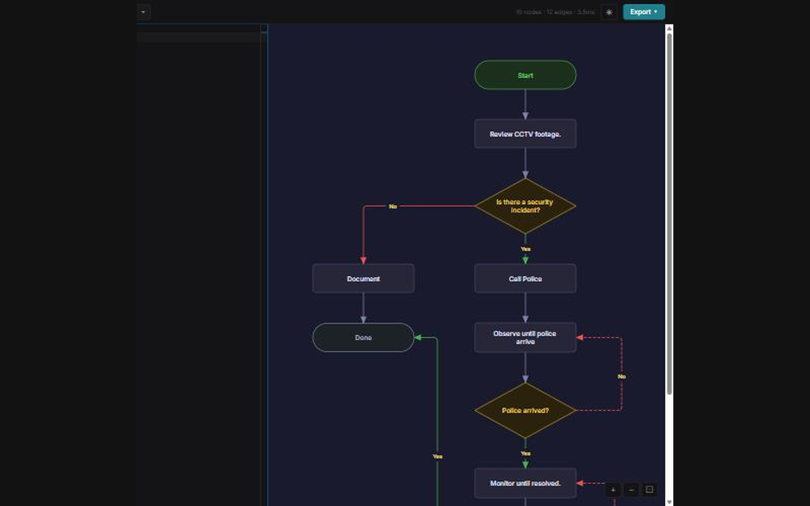

# FlowScript for Obsidian

Render ` ```flow ` code blocks as inline SVG flowcharts inside any Obsidian note.



FlowScript code blocks in Obsidian normally display as raw text. This plugin runs them through the FlowScript compiler and replaces the block with an inline SVG — no copy-paste, no external app, no internet required.

## What it does

- **Inline rendering** — every ` ```flow ` block in a note becomes a live SVG diagram in reading and preview modes
- **Full DSL support** — decisions, branches, loops and swimlanes all work exactly as in the [FlowScript editor](https://flowscript.foxanddoveconsulting.com/editor.html)
- **Local compilation** — the FlowScript engine runs entirely inside Obsidian; no outbound requests
- **Auto-update** — editing the code block and switching back to reading mode re-renders the diagram instantly
- **Lightweight** — a single bundled JavaScript file; no background processes

## Quick start

1. Download `main.js`, `manifest.json` and `styles.css` from the [latest release](https://github.com/kilrkrow/flowscript-for-obsidian/releases)
2. Copy them into `<vault>/.obsidian/plugins/flowscript-diagrams/`
3. Enable **FlowScript Diagrams** in Obsidian Settings > Community plugins

Or install via [BRAT](https://github.com/TfTHacker/obsidian42-brat): add `kilrkrow/flowscript-for-obsidian`.

Then write a flow block in any note:

````
```flow
#start User Opens Note
  Edit .flow Block
  #decision Looks Right?
    -> yes: Done
    -> no: Edit Again
```
````

## Install via BRAT

1. Install BRAT from Community plugins
2. In BRAT settings, choose **Add Beta Plugin**
3. Enter `kilrkrow/flowscript-for-obsidian`

## License

[MIT](LICENSE)

## Feedback

Questions, ideas and bug reports are welcome in [Issues](https://github.com/kilrkrow/flowscript-for-obsidian/issues).

---

Built by Guy Schamp · [Fox & Dove](https://foxanddoveconsulting.com) · more tools at [github.com/kilrkrow](https://github.com/kilrkrow)
